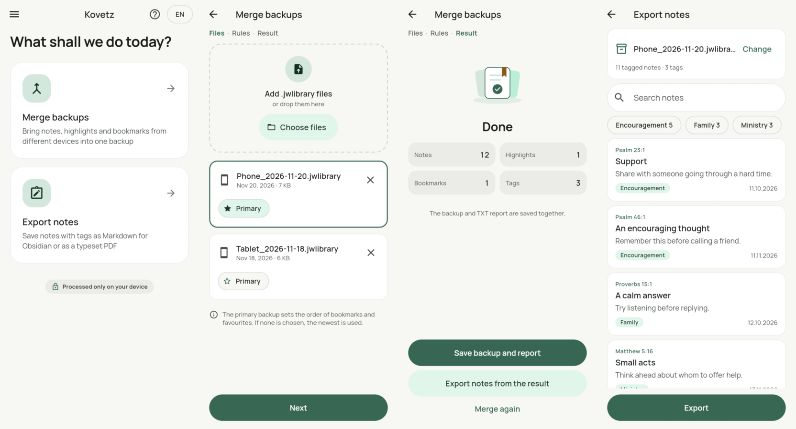
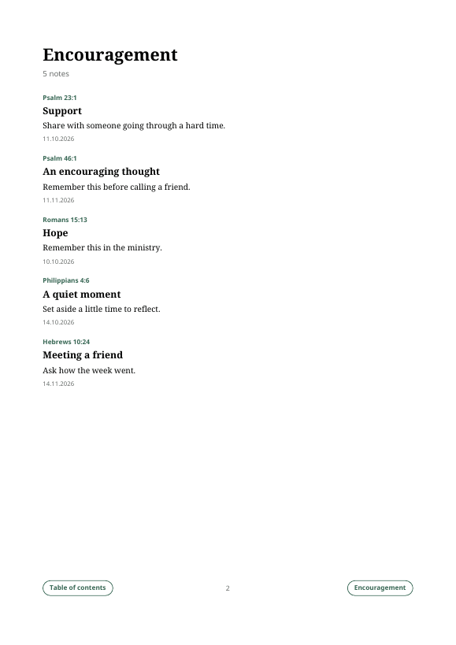

# Kovetz

**All your JW Library notes in one place**

A free app for Android, Windows and Linux that merges JW Library backups from different devices and exports your notes to PDF and Markdown (Obsidian).

[Download](https://github.com/pioner14/kovetz/releases/latest) · [Guide and website](https://pioner14.github.io/kovetz-site/) · [Русский](README.md)

> Kovetz is an independent app. It is not affiliated with JW Library or its developers.

## What it is

Every device keeps its own notes, highlights and bookmarks, and restoring a backup in JW Library **replaces** everything on that device. Kovetz takes the backups from your phone, tablet and computer (even from different years) and builds **one combined backup** where nothing is lost.

## Features

- **Merge backups.** Three steps: files, rules, result. Your original files are never changed. If one note was edited on two devices, the newer version wins and the other is kept in the report.
- **PDF export.** A book with a table of contents by tag, page numbers and navigation buttons. Cyrillic, Armenian, Hebrew and other scripts print without empty boxes.
- **Markdown export for Obsidian.** One note per file, the source in the properties, and an index page for every tag.
- **Update check** by button or once a day (off by default).
- **No internet, no ads.** The only network request is the optional check for new versions on GitHub.

  

## Where it runs

| System | Status | How it was checked |
|---|---|---|
| **Android 7.0+** (API 24) | ✅ tested | A real Xiaomi phone: merging, restoring the result in JW Library, export |
| **Linux x86-64** | ✅ tested | Desktop Arch Linux (Omarchy): launch and full use; build and tests in CI on Ubuntu 24.04 |
| **Windows 10/11 x86-64** | 🧪 CI tests | Build and automated tests on Windows Server 2025; not yet tried by hand on a real PC |
| Android tablets | ➖ not tested | Expected to work like the phone |
| macOS, iOS | ❌ not supported | No builds |

Tested with JW Library backups using database schema versions 5, 8, 14 and 16 (both variants of 16).

## Languages

- **Interface and reports:** Russian and English (switch inside the app).
- **PDF printing:** Cyrillic, Latin, Greek, Armenian, Hebrew and other scripts.
- **Written in:** Dart and Flutter (most of the code), Kotlin (saving files on Android), C++ (Windows and Linux shells).

## Install

Download the file for your system from the [releases page](https://github.com/pioner14/kovetz/releases/latest):

- `kovetz-<version>-android-arm64.apk` — Android, 64-bit ARM (almost all modern phones and tablets); allow installing from your browser;
- **Windows.** Run `kovetz-<version>-windows-x64-setup.exe` and follow the installer prompts. The installer isn't signed with a certificate yet. If SmartScreen shows a warning, click “More info”, then “Run anyway”.
- **Linux.** Download `kovetz-<version>-linux-x86_64.AppImage`. In your downloads folder, run `chmod +x kovetz-*-linux-x86_64.AppImage`, then double-click the file. If the AppImage fails to start, install `libfuse2` (`libfuse2t64` on Ubuntu 24.04) or run the file with `--appimage-extract-and-run`.

> **Android is built for arm64 only.** That covers almost all phones and tablets from recent years, and the file is about three times smaller (around 23 MB). If you need another architecture (armeabi-v7a, x86_64), open an [issue](https://github.com/pioner14/kovetz/issues) and I will build it for you.

SHA-256 checksums are published next to the files. Illustrated guide: https://pioner14.github.io/kovetz-site/

## For developers

The code lives in [app/](app/README.md): building, tests, Android signing, releases. Specs are in [docs/specs](docs/specs/app-platforms.md). Contributing: [CONTRIBUTING.md](CONTRIBUTING.md). Website: [kovetz-site](https://github.com/pioner14/kovetz-site).

## Support

Kovetz is made by one person in their spare time. If it helped you, you can [buy the author a coffee](https://paypal.me/NikolaiGolotaistrov). It is entirely optional.

© 2026 Nikolai Golotaistrov · MIT License
