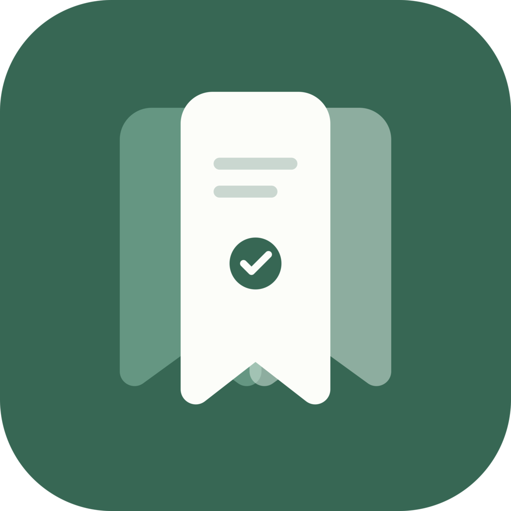
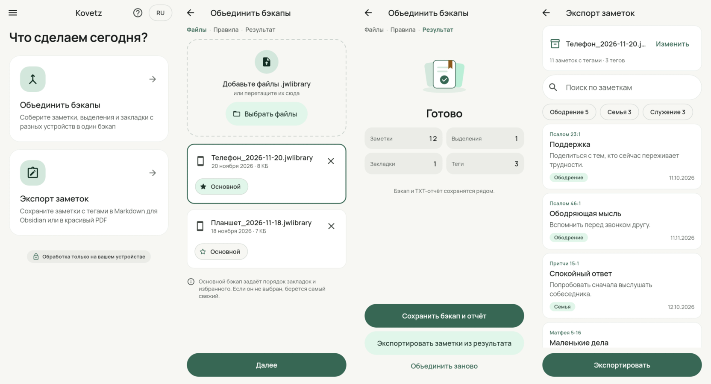
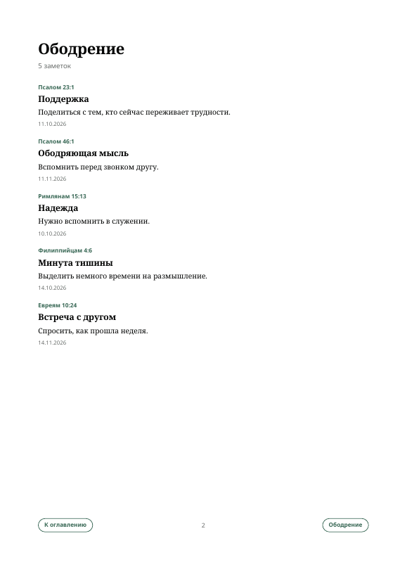

# Kovetz

**Все ваши заметки JW Library — в одном месте**

Бесплатная программа для Android, Windows и Linux: объединяет резервные копии JW Library с разных устройств и сохраняет заметки в PDF и Markdown (Obsidian).

[Скачать](https://github.com/pioner14/kovetz/releases/latest) · [Руководство и сайт](https://pioner14.github.io/kovetz-site/) · [English](README.en.md)

> Kovetz — независимая программа. Она не связана с JW Library и её разработчиками.

## Что это

На каждом устройстве у вас свои заметки, выделения и закладки, а восстановление резервной копии в JW Library **заменяет** всё, что там было. Kovetz берёт копии с телефона, планшета и компьютера (в том числе сделанные в разные годы) и собирает из них **одну общую**, из которой ничего не пропадает.

## Почему «Kovetz»

*Ковец* (קוֹבֶץ) на иврите означает «сборник», «собрание», а также «файл». Слово происходит от корня, который значит «собирать». Именно это программа и делает: собирает заметки с разных устройств в одну копию.

## Что умеет

- **Объединить бэкапы.** Три шага: файлы, правила, результат. Исходные файлы не меняются. Если одна заметка изменена на двух устройствах, выбирается свежая версия, а вторая остаётся в отчёте.
- **Экспорт заметок в PDF.** Книга с оглавлением по тегам, номерами страниц и кнопками перехода. Русский, армянский, иврит и другие языки печатаются без пустых квадратов.
- **Экспорт в Markdown для Obsidian.** Одна заметка — один файл, источник в свойствах, страница-оглавление для каждого тега.
- **Проверка обновлений** по кнопке или раз в сутки (по умолчанию выключена).
- **Без интернета и рекламы.** Единственное обращение в сеть — необязательная проверка новых версий на GitHub.

  

## Где работает

| Система | Статус | Как проверено |
|---|---|---|
| **Android 7.0+** (API 24) | ✅ проверено | Реальный телефон Xiaomi: объединение, восстановление результата в JW Library, экспорт |
| **Linux x86-64** | ✅ проверено | Настольный Arch Linux (Omarchy): запуск и вся работа; сборка и тесты в CI на Ubuntu 24.04 |
| **Windows 10/11 x86-64** | ✅ проверено на Windows 11 | Windows 11 последней сборки: установка, запуск, вся работа. Минимум — Windows 10 (64-бит); на Windows 10 вручную не проверялось. Сборка и автотесты в CI на Windows Server 2025 |
| Планшеты Android | ➖ не проверялось | Должно работать, как на телефоне |
| **macOS 12+** (Apple Silicon и Intel) | 🧪 экспериментально | Сборка и автотесты проходят в CI на macOS, но на живом Mac не пробовали; приложение не подписано Apple |
| iOS | ❌ не поддерживается | Сборок нет |

Проверялись резервные копии JW Library со схемами базы версий 5, 8, 14 и 16 (оба варианта 16).

## Языки

- **Интерфейс и отчёты:** русский и английский (переключается в приложении).
- **Печать PDF:** кириллица, латиница, греческий, армянский, иврит и другие письменности.
- **Написано на:** Dart и Flutter (основная часть), Kotlin (сохранение файлов на Android), C++ (оболочки Windows и Linux).

## Установка

Скачайте файл для своей системы на странице [релизов](https://github.com/pioner14/kovetz/releases/latest):

- `kovetz-<версия>-android-arm64.apk` — Android, 64-бит ARM (почти все современные телефоны и планшеты); разрешите установку из браузера;
- **Windows.** Запустите установщик `kovetz-<версия>-windows-x64-setup.exe` и следуйте его подсказкам. Установщик пока не подписан сертификатом. Если появится предупреждение SmartScreen, нажмите «Подробнее», затем «Выполнить в любом случае».
- **Linux.** Скачайте `kovetz-<версия>-linux-x86_64.AppImage`. В папке загрузок выполните `chmod +x kovetz-*-linux-x86_64.AppImage`, затем запустите файл двойным щелчком. Если AppImage не запускается, установите `libfuse2` (`libfuse2t64` в Ubuntu 24.04) или запустите файл с параметром `--appimage-extract-and-run`.
- `kovetz-<версия>-macos-universal.zip` — macOS (экспериментально): распакуйте и перетащите `Kovetz.app` в «Программы». При первом запуске macOS предупредит о неизвестном разработчике: нажмите правой кнопкой на приложение → «Открыть» → «Открыть» (или разрешите в «Системные настройки → Конфиденциальность и безопасность»). Если у вас Mac и вы попробуете, напишите в [Issues](https://github.com/pioner14/kovetz/issues), как всё прошло.

> **Android собран только для arm64.** Это почти все телефоны и планшеты последних лет, а файл получается втрое меньше (около 23 МБ). Если вам нужна сборка для другой архитектуры (armeabi-v7a, x86_64), напишите об этом в [Issues](https://github.com/pioner14/kovetz/issues): я соберу её отдельно.

Рядом лежат контрольные суммы SHA-256. Подробное руководство с картинками: https://pioner14.github.io/kovetz-site/

## Ищу бета-тестеров

Я хочу опубликовать Kovetz в Google Play, и для этого нужны тестировщики на Android. Если вы пользуетесь JW Library и готовы пару недель пробовать программу, [создайте обращение (Issue)](https://github.com/pioner14/kovetz/issues/new) и коротко расскажите о своём устройстве: я отвечу и объясню, что делать дальше.

## Для разработчиков

Код находится в [app/](app/README.md): сборка, тесты, подпись Android, выпуск версий. Спецификации — в [docs/specs](docs/specs/app-platforms.md). Вклад в проект — [CONTRIBUTING.md](CONTRIBUTING.md). Сайт: [kovetz-site](https://github.com/pioner14/kovetz-site).

## Поддержать

Kovetz делает один человек в свободное время. Если программа помогла, можно [угостить автора кофе](https://paypal.me/NikolaiGolotaistrov). Это необязательно.

© 2026 Nikolai Golotaistrov · Лицензия MIT
