# Kovetz user guide

Begin with “Save your backups first”. Take it one step at a time. Your original files always stay as they were.

## What the app does

Kovetz helps you bring your JW Library records together in one place.

You may have some notes on your phone and others on your tablet. Kovetz reads the saved copies from those devices and makes one new copy. It can bring together notes, tags, highlights, bookmarks, favourites, answers and playlists.

You can also save notes as a file to read or in a folder for Obsidian. To put your records back into JW Library, restore the backup in JW Library itself.

- Use an Android phone or a Windows or Linux computer.
- Merging needs at least two different JW Library backups. Saving notes needs only one backup with tagged notes.
- Leave some free space for the new backup and its report.

> **Tip.** You can work with saved backups offline. Kovetz does not replace JW Library or move downloaded publications, and it never changes your original files.

## Install and update

Follow the steps for your phone or computer.

### 1. Android · Open the release page

Open the Kovetz releases page on [GitHub](https://github.com/pioner14/kovetz/releases). In the latest release’s Assets list, choose the Android APK.

### 2. Android · Open the downloaded file

Wait for the download and tap the file. If the phone asks for permission, open the suggested settings and allow installs from this source.

### 3. Android · Install the app

Return to the installer and tap “Install”. When “Open” appears, tap it.

### 4. Windows · Download the ZIP

On the Kovetz releases page on [GitHub](https://github.com/pioner14/kovetz/releases), choose the Windows ZIP. Find the downloaded file in your Downloads folder.

### 5. Windows · Extract the files

Right-click the ZIP and choose “Extract All”. Open the folder that was created.

### 6. Windows · Start Kovetz

Double-click “backup_merge.exe” in that folder. Leave the other files beside it.

### 7. Linux · Download the archive

On the Kovetz releases page on [GitHub](https://github.com/pioner14/kovetz/releases), choose the Linux archive. Its name ends in .tar.gz.

### 8. Linux · Unpack the archive

In Downloads, right-click the archive. Choose “Extract Here” or a similar option.

### 9. Linux · Start Kovetz

Open the extracted folder and then its “bundle” folder. Run “backup_merge” and leave the “data” and “lib” folders beside it.

### 10. Update · Check the version

Open the menu, choose “Updates” and then “Check for updates”. Wait for the reply.

### 11. Update · Get the new file

If a new version appears, press “Download” or “Release page”. On the release page, choose the file for your device on [GitHub](https://github.com/pioner14/kovetz/releases).

### 12. Update · Open the new version

On Android, open the new APK and confirm the update. On a computer, close the old app, unpack the new version into a different folder and run it from there.

## Home screen and menu

The home screen lets you get started or change how the app looks.

### 1. Find the card you need

Press “Merge backups” for one combined copy or “Export notes” to read your notes outside JW Library. For settings, press the button with three lines.

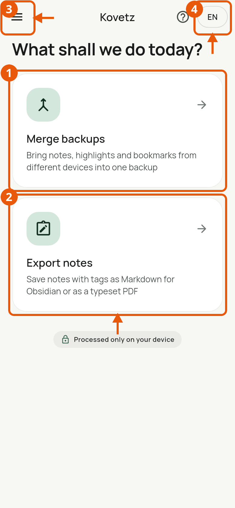

1 — “Merge backups”. 2 — “Export notes”. 3 — menu button. 4 — language button.

### 2. Open the menu

Press the button with three lines. Choose the row you need, such as “How to use”, or press “Home” to close the menu.

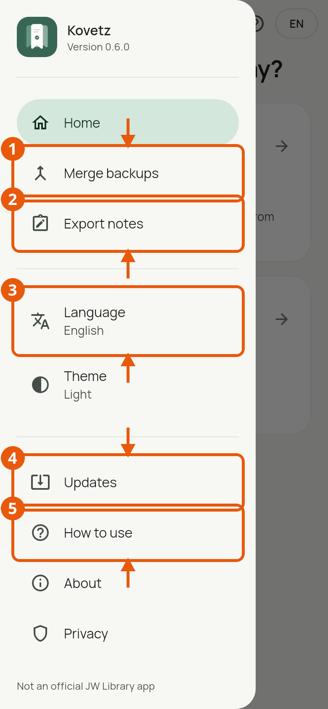

1 — “Merge backups”. 2 — “Export notes”. 3 — “Language”. 4 — “Updates”. 5 — “How to use”.

### 3. Choose a language

Press the language button at the top or “Language” in the menu. In “App language”, press the row you want.

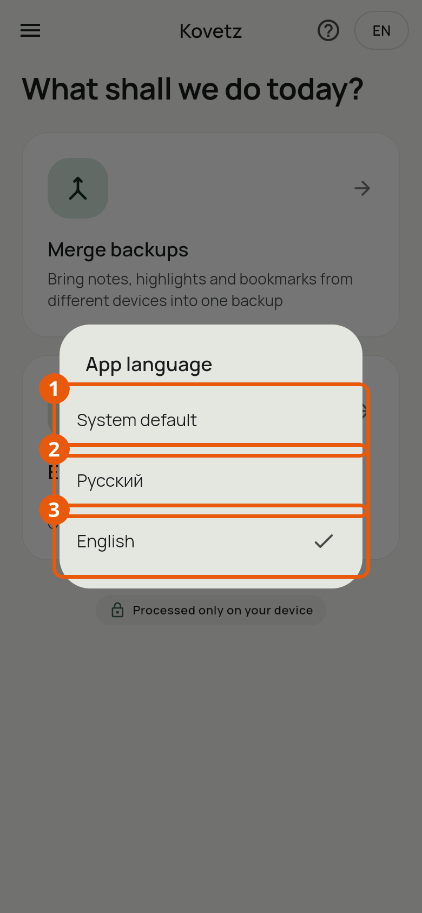

1 — “System default”, the device language. 2 — “Русский”, Russian. 3 — “English”.

### 4. Choose a theme

Open the menu and press “Theme”. Choose “Light”, “Dark” or “System” to follow the device setting.

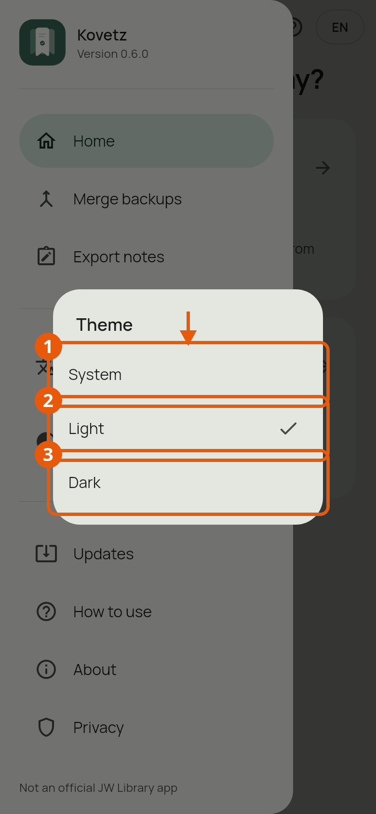

1 — “System”. 2 — “Light”. 3 — “Dark”.

### 5. See information about the app

In the menu, press “About”. To copy the project address, press “Source code — GitHub”. Paste it into your browser to open the page.

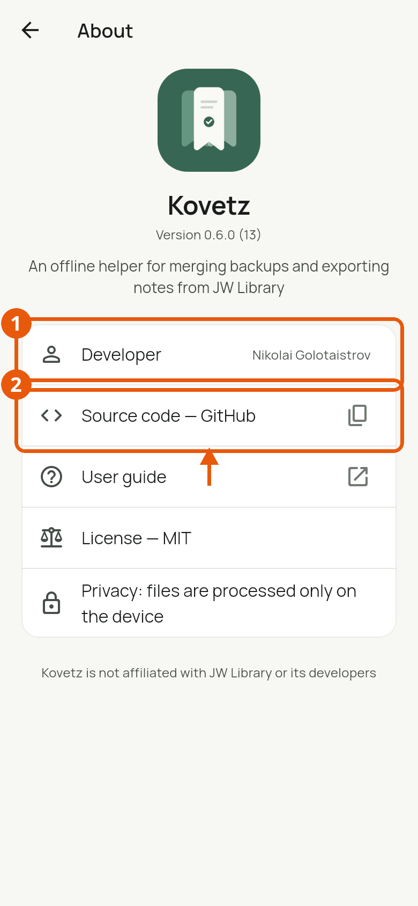

1 — “Developer”, the author’s name. 2 — “Source code — GitHub”, the row that copies the link.

## Save your backups first

A fresh backup lets you get your phone’s records back if you want to go back.

> **Important.** Restoring in JW Library replaces the personal records on that device with the records from the chosen backup. A new note that is missing from the backup may disappear from the phone. Start with a fresh backup.

### 1. Open “My Notes”

Open JW Library on your phone. Go to “My Notes”.

### 2. Open the backup menu

Tap the cloud icon with an arrow. Choose the option to create a backup.

### 3. Save the phone backup

Choose to save to a file if your phone offers several choices. Pick a folder you can find again and confirm the save.

### 4. Make sure the file is there

Open the folder in your files app. Remember the file name and where you saved it.

### 5. Back up the other devices

Repeat these steps on your tablet and any other device with records you want. If you merge on a computer, copy each file there, for example with a cable.

### 6. Keep your original backups

Keep the files made by JW Library somewhere safe. Keep them after the merge too.

## How to merge backups

Three screens help you choose files, set the rules and save the result.

### 1. Files · Start the merge

On the home screen, press “Merge backups”. On “Files”, press “Choose files”.

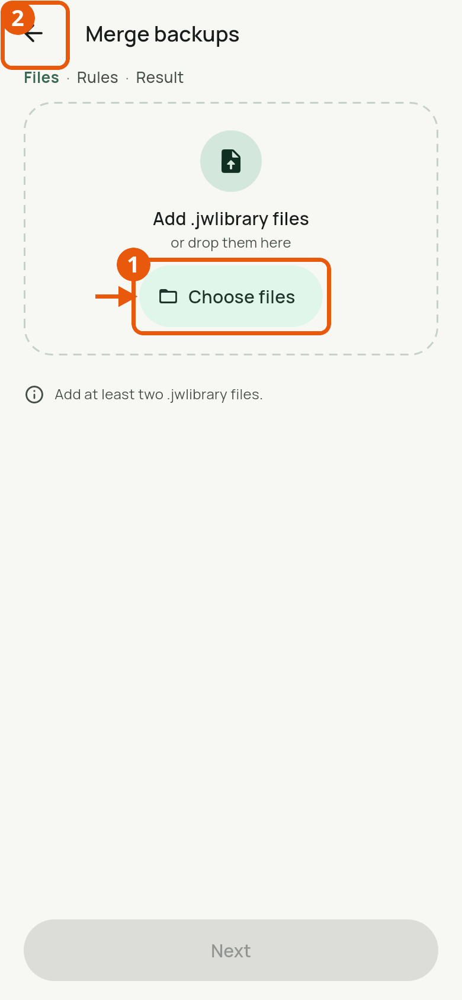

1 — “Choose files”. 2 — back arrow to leave this screen.

### 2. Files · Add two or more backups

Select at least two different JW Library backup files ending in .jwlibrary. If you selected only one, press “Choose files” again to add another.

### 3. Files · Choose the primary backup

Press the star marked “Primary” under the file you want to give priority. That file sets the order of favourites and gets first choice of bookmark slots.

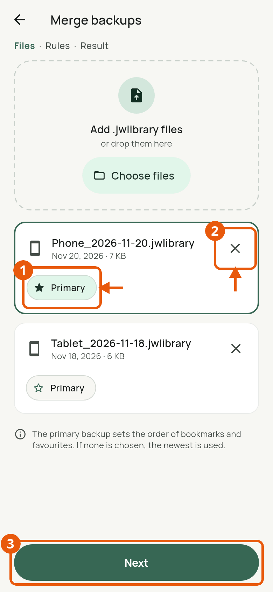

1 — “Primary”. 2 — “Remove file” cross. 3 — “Next”.

### 4. Files · Check the list and go on

If you added the wrong file, press the cross beside it. If you leave all stars unselected, the app uses the newest backup as the primary one. Press “Next”.

### 5. Rules · Choose which note version to keep

In “Notes with the same ID”, press “Newest version” or “From the primary backup”. This rule applies when the same note was changed in different ways.

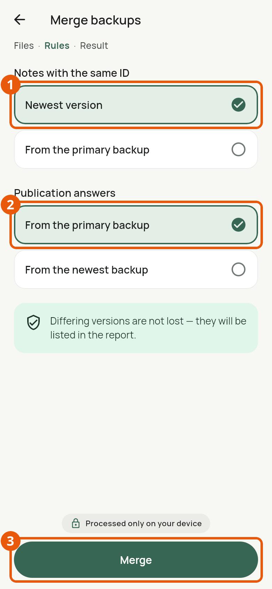

1 — “Newest version” for notes. 2 — “From the primary backup” for answers. 3 — “Merge”.

### 6. Rules · Choose which answers to keep

In “Publication answers”, press “From the primary backup” or “From the newest backup”. The second choice uses the date of the whole backup.

> **Tip.** If you are unsure, keep the suggested choices. Different notes stay separate, and you can read differing versions of a note or an answer in the report.

### 7. Rules · Start merging

Press “Merge”. The app opens “Result” and starts working.

### 8. Result · Wait or cancel

While the circle moves, wait. To stop, press “Cancel” and wait for it to finish stopping. Your original files stay as they were.

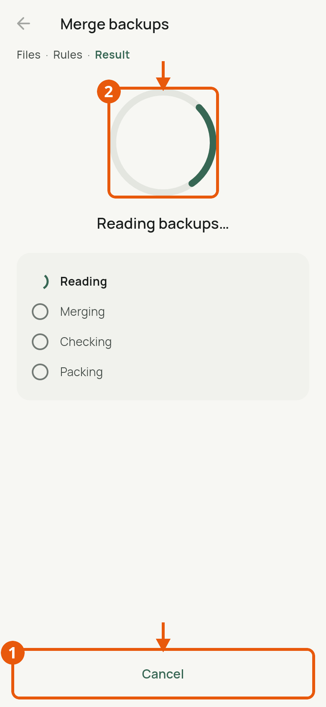

1 — “Cancel”. 2 — the moving circle that shows work is in progress.

### 9. Result · Look at what was saved

When you see “Done”, look at the counts under the heading. If there is a yellow “Review … records” message, save the result and read the report before restoring.

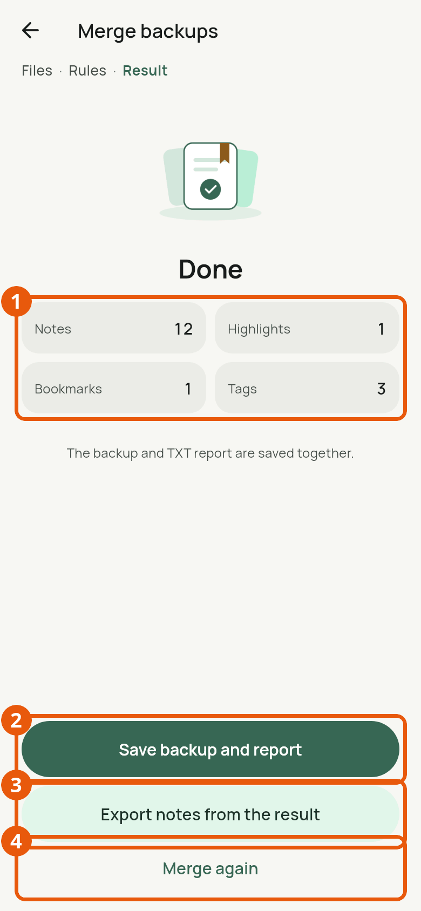

1 — counts of saved records. 2 — “Save backup and report”. 3 — “Export notes from the result”. 4 — “Merge again”.

> **Important.** The yellow message means some records need attention. For example, a bookmark slot may have been full or a playlist file may have been missing. The report explains what happened.

### 10. Result · Save on your device

Press “Save backup and report”. On Android, choose a folder and confirm. On a computer, choose a folder and a name for the new backup, then press “Save”.

### 11. Result · Find both files

Open the chosen folder and look for the new .jwlibrary backup and its .report.txt report. If you saw a warning, open the report as a plain text file.

### 12. Result · Continue if you need to

To save notes separately, press “Export notes from the result”. To choose your files or rules again, press “Merge again”.

> **Tip.** If you close the folder picker, the result stays on the screen. On Android, previously saved files stay in place. On a computer, if the names match, you can cancel replacement and choose a new name.

## How to restore in JW Library

Make sure you have a fresh phone backup before restoring the combined one.

### 1. Check your phone backup

Make sure you have a fresh file from “Save your backups first”. Restoring replaces the personal JW Library records on this phone.

### 2. Find the merged backup on your phone

If the merged backup is on a computer, copy it to the phone, for example with a cable. Restore the .jwlibrary backup itself and keep the TXT report beside it if you wish.

### 3. Open the backup menu

Open JW Library and go to “My Notes”. Tap the cloud icon with an arrow and choose “Restore”.

### 4. Choose the merged backup

Choose the merged backup from the folder where you saved it. If your phone opened the file directly in JW Library, wait for the restore prompt.

### 5. Confirm the restore

Check that you picked the right file. Confirm the restore and wait for it to finish.

### 6. Check familiar records

Open “My Notes” and find a familiar note from each device. Check a few important tags, bookmarks or highlights too.

### 7. If JW Library says the saved data is damaged

Check that you opened the merged backup and that the whole file was copied. If it still fails, merge the originals again in a current version of Kovetz and save under a new name.

### 8. Go back to your phone’s records if needed

If the merged backup is not right for you, use the same steps to restore the phone’s own fresh backup. If the merged backup still fails, write down the error and the Kovetz version from “About” for the developer.

## How to export notes

You can save your notes as a folder to read or as a book.

The app saves the words you wrote in your notes. By default, it includes only notes with tags. Highlights, bookmarks and publication text are left out of the export.

### 1. Overview · Open a backup

On the home screen, press “Export notes”, then “Choose a backup”. Choose the JW Library file and wait for the list.

### 2. Overview · Or use the merged backup

On the “Done” screen, press “Export notes from the result”. If you opened a regular backup and want a different one, press “Change”.

### 3. Overview · Find a note

Press “Search notes” and type a word. Press a tag below the search box to see notes with that label.

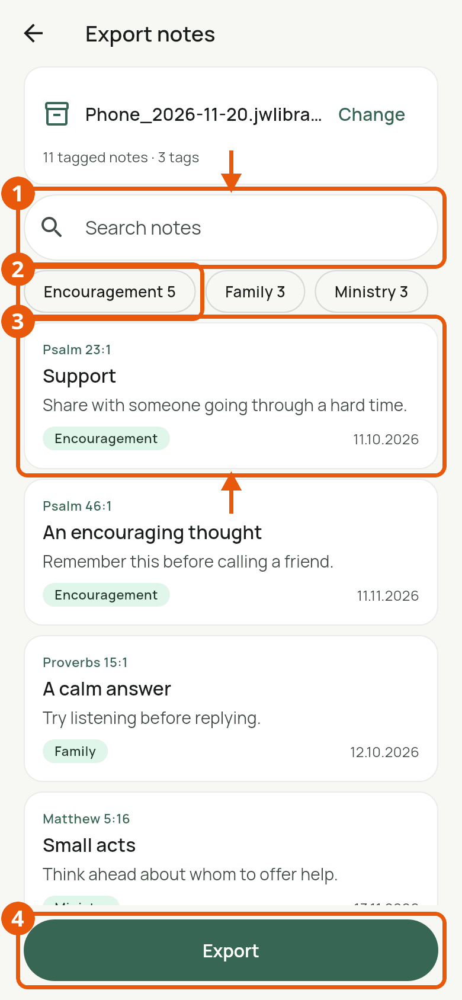

1 — “Search notes”. 2 — the first tag and its note count. 3 — the first note card. 4 — “Export”.

### 4. Overview · Go to export

To clear the search, press the “Clear” cross, and to clear a tag filter, press the same tag again. Press “Export”. Search and tag choices only change the list you see.

### 5. Markdown · Choose the format

Press “Markdown for Obsidian”. If you also want untagged notes, turn on “Include notes without tags”.

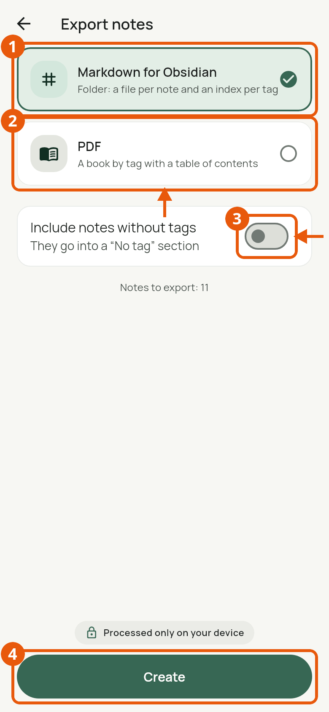

1 — “Markdown for Obsidian”. 2 — “PDF”. 3 — “Include notes without tags”. 4 — “Create”.

### 6. Markdown · Save the export

Press “Create”. On a computer, choose where to make the new folder, or on Android choose where to save the ZIP.

### 7. Markdown · Unzip on your phone

On Android, find the ZIP in your files app. Open it and choose “Extract” or a similar button. On a computer, the folder is already ready.

### 8. Markdown · Open the folder in Obsidian

Open Obsidian and choose “Open folder as vault”. Pick the whole export folder, the one that contains “Index”.

### 9. Markdown · Open “Index”

Press “Index” to browse the tags. “Notes” has one file per note, and “Tags” has lists of notes by topic.

### 10. PDF · Choose the book

On the format screen, press “PDF”. For an “Untagged” section in the book, turn on “Include notes without tags”.

### 11. PDF · Choose the order and save the book

Under “Order inside a tag”, press “By Bible and publication” or “By date”, from older notes to newer ones. Press “Create”. Wait for the save window and choose where to put the file.

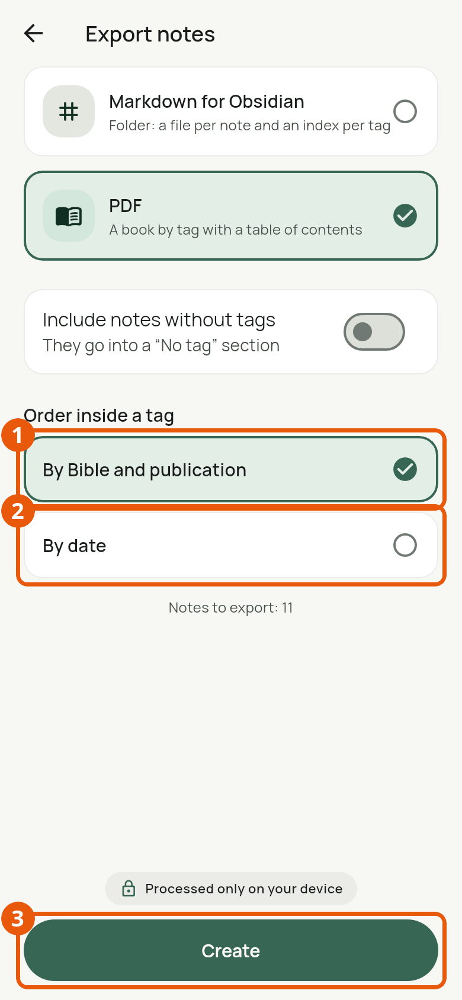

1 — the two choices for the order inside a tag. 2 — “Create”.

> **Tip.** A book of about 1,700 notes can take around 10 seconds to make. It may take longer on a slower device.

### 12. PDF · Open the cover and contents

Open the saved PDF. To go to a topic, press the tag name in “Contents by tag” or find the page yourself.

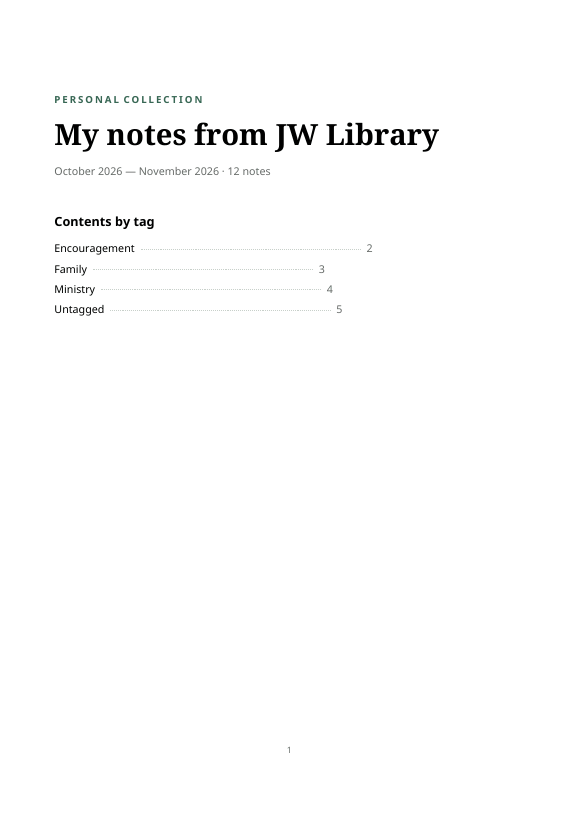

1 — the book title on the cover. 2 — the contents with the list of tags.

### 13. PDF · Read the notes for a topic

Scroll through the pages for your topic. There are no buttons to press on this book page. If a note has several tags, it is printed once in each of those sections.

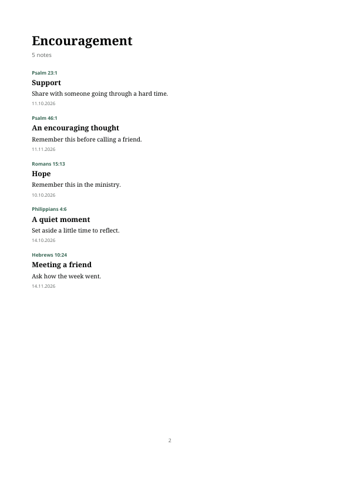

1 — the tag name. 2 — the note text. You can simply read here.

## Language, theme and updates

You can change the settings whenever you like.

### 1. Set the language

Open the menu and press “Language”. In “App language”, press “Русский”, “English” or “System default”.

### 2. Set the theme

Open the menu and press “Theme”. Choose “Light”, “Dark” or “System”.

### 3. Check for updates yourself

Open the menu and press “Updates”. Press “Check for updates” and wait.

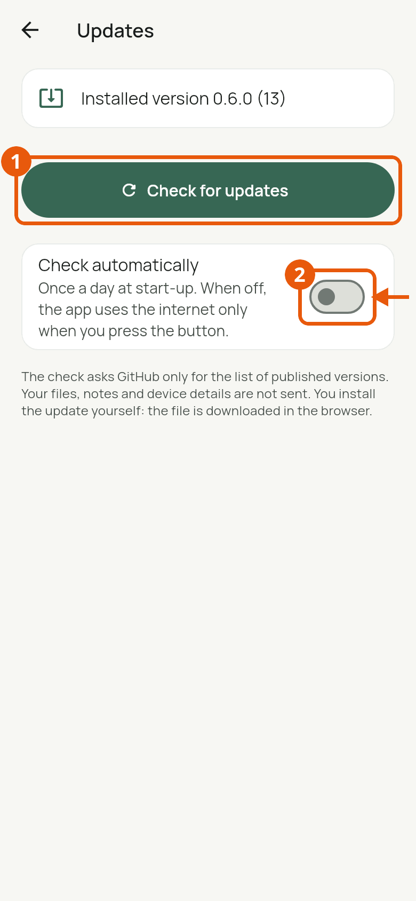

1 — “Check for updates”. 2 — the “Check automatically” switch.

### 4. Read the answer

If it says “You have the latest version”, you can carry on. If a new version is available, press “Download” or “Release page” and go back to “Install and update”.

### 5. Turn start-up checks on or off

Press “Check automatically” if you want a check at start-up once a day. It starts off. To check only when you ask, turn it off again.

Kovetz only asks GitHub for a list of published versions. The check does not send your files, notes or device details.

## If something goes wrong

Find the message or situation you recognise and try the step beside it.

A file name may appear before the message. It tells you which backup to check.

### 1. “Could not read the file as a JW Library backup”

It may be the wrong kind of file or an incomplete copy. Take a backup made by JW Library and copy it again.

### 2. “The database version disagrees with the backup manifest”

Two parts of the file disagree about its format. Make a fresh backup in JW Library and add it.

### 3. “Unrecognized structure of table”

The app found an unfamiliar way of storing records. Check for updates and, if the error returns, write down the full message for the developer.

### 4. “Backup schema version … is currently unsupported”

The app cannot read this kind of backup yet. Keep it and try a fresh backup from an updated JW Library.

### 5. “The backup database references missing records”

Some records point to other records that are missing from the file. Choose a working original backup from that device.

### 6. “The database failed its integrity check”

The records inside the file did not pass a check. Copy the original again or make a fresh backup in JW Library.

### 7. “The backup contents do not match its checksum”

A check found that the contents differ from what was saved. Copy the original file again or make a fresh backup.

### 8. “The backup is too large or contains too many files”

The app stopped because of the size of the backup. If you have a smaller original with the records you need, try it and keep the large one.

### 9. “The recovery report inside this earlier merge result is damaged”

The app cannot read the report inside an older result. Choose the backups made by JW Library itself.

### 10. “A media file referenced by a playlist is missing”

A file used by a playlist is missing from the backup. Add a fresh backup from a device that still has the file.

### 11. “Could not read or write a file”

Check that the file is available on the device and that the save folder has room. Try again or choose a different folder.

### 12. “Merge cancelled”

The app stopped after you pressed “Cancel”. To start again, go back to the rules and press “Merge”.

### 13. “Internal error”

Something went wrong inside the app, and your original files stayed as they were. Try once more and, if it happens again, write down the message and the app version for the developer.

### 14. “Add at least two different backups”

One file or two copies of the same backup are not enough. Press “Choose files” and add a different JW Library backup.

### 15. “Could not merge the backups”

For example, the chosen primary backup may be unavailable. Go back to the list, check the files and pick “Primary” again under the backup you want.

### 16. The button is grey

For “Next”, add two different backups, and for “Export”, use a backup with at least one tagged note. If the app is still reading or saving, wait for it to finish.

### 17. You added the wrong file

Go back to “Files” and press the “Remove file” cross beside the wrong name. If needed, add the right backup with “Choose files”.

### 18. The screen shows a previous result

If you changed the language, files or rules, press “Merge again”. Check the list and rules, then press “Merge” to enable saving or exporting again.

### 19. “Cannot reach GitHub”

Check your connection and press “Check for updates” again later. You can still merge backups and export notes while offline.

### 20. You cancelled the folder or file picker

If you closed the save window, press “Save backup and report” again, or “Create” for notes. If you closed the backup picker, open it again when ready.

### 21. The files could not be saved

Check the free space and pick a different folder or a new name. If the app warns that files may be incomplete, use the new result only after it confirms a successful save.

## Where your data stays

Your files are processed on your phone or computer.

The original files stay where you put them. The new backup, report and exported notes go where you choose to save them. The report can also contain personal text.

The app uses the internet only to check for updates. It asks GitHub for the list of releases. It does not send backups, notes or device details.

While working, the app makes temporary copies in its own area on the device. It removes them after use. If work was interrupted, it tries to clear the leftovers at the next start.

## Words in this guide

Here are short explanations for words you may see on the screen.

- Backup. A file in which JW Library saves your records so you can bring them back later.
- Merge. Bring records from several backups together into one new backup.
- Primary backup. The starred copy that sets the order of favourites and gets first choice of bookmark slots.
- Note. Something you wrote for yourself.
- Tag. A short topic label, such as “Family”. It helps you find notes about the same thing.
- Highlight. A place in the text you marked with colour.
- Bookmark. A mark for a place you want to come back to.
- Report. A text file beside the merged backup. It tells you what was saved and what needs a look.
- Markdown. A simple kind of text file that uses marks for headings, lists and links.
- Obsidian. An app for reading and organising notes in a folder.
- PDF. A file with pages you can read and print like a book.
- Release. A version of the app that the developer has put up for download.
