# Руководство по Kovetz

Начните с главы «Сначала сохраните копии». Дальше идите по одному шагу за раз. Ваши исходные файлы всегда остаются как были.

## Для чего нужно приложение

Kovetz помогает собрать ваши записи из JW Library в одном месте.

В телефоне могут быть одни заметки, а в планшете другие. Kovetz читает сохранённые копии с этих устройств и делает из них одну новую копию. В ней могут быть заметки, теги, выделения, закладки, избранное, ответы и списки воспроизведения.

Можно также сохранить заметки отдельным файлом для чтения или в папку для Obsidian. Чтобы вернуть записи в JW Library, восстановите копию в самой JW Library.

- Подойдёт телефон с Android или компьютер с Windows либо Linux.
- Для объединения нужны хотя бы две разные копии JW Library. Для сохранения заметок хватит одной копии с заметками, у которых есть теги.
- Оставьте немного свободного места для новой копии и отчёта.

> **Совет.** Готовые копии можно обрабатывать без интернета. Kovetz не заменяет JW Library, не переносит скачанные публикации и никогда не меняет исходные файлы.

## Установка и обновление

Достаточно выполнить шаги для своего телефона или компьютера.

### 1. Android · Откройте страницу выпуска

Откройте страницу выпусков Kovetz на [GitHub](https://github.com/pioner14/kovetz/releases). В списке файлов свежего выпуска выберите APK для Android.

### 2. Android · Откройте скачанный файл

Дождитесь загрузки и нажмите на скачанный файл. Если телефон попросит разрешение, откройте предложенные настройки и разрешите установку из этого источника.

### 3. Android · Установите приложение

Вернитесь к установщику и нажмите «Установить». Когда появится кнопка «Открыть», нажмите её.

### 4. Windows · Скачайте ZIP

На странице выпусков Kovetz на [GitHub](https://github.com/pioner14/kovetz/releases) выберите ZIP для Windows. Найдите скачанный файл в папке загрузок.

### 5. Windows · Извлеките файлы

Щёлкните по ZIP правой кнопкой и выберите «Извлечь всё». Откройте папку, которая получилась.

### 6. Windows · Запустите Kovetz

Дважды щёлкните по файлу со значком Kovetz в этой папке. В списке файлов у него тип «Приложение». Оставьте остальные файлы рядом с ним.

### 7. Linux · Скачайте архив

На странице выпусков Kovetz на [GitHub](https://github.com/pioner14/kovetz/releases) выберите архив для Linux. Это сжатый файл с двумя точками в конце имени.

### 8. Linux · Распакуйте архив

В папке загрузок щёлкните по архиву правой кнопкой. Выберите «Извлечь сюда» или похожий пункт.

### 9. Linux · Запустите Kovetz

Откройте получившуюся папку и её внутреннюю папку с приложением. Запустите файл приложения со значком Kovetz и оставьте соседние папки на месте.

### 10. Обновление · Проверьте версию

Откройте меню, нажмите «Обновления», затем «Проверить обновления». Дождитесь ответа.

### 11. Обновление · Скачайте новый файл

Если появилась новая версия, нажмите «Скачать» или «Страница релиза». Во втором случае выберите файл для своего устройства на открывшейся странице [GitHub](https://github.com/pioner14/kovetz/releases).

### 12. Обновление · Откройте новую версию

На Android откройте новый APK и подтвердите обновление. На компьютере закройте старую версию, распакуйте новую в другую папку и запустите её оттуда.

## Главный экран и меню

С главного экрана можно начать работу и поменять вид приложения.

### 1. Найдите нужную карточку

Нажмите «Объединить бэкапы» для общей копии или «Экспорт заметок» для чтения заметок вне JW Library. Для настроек нажмите кнопку с тремя полосками.

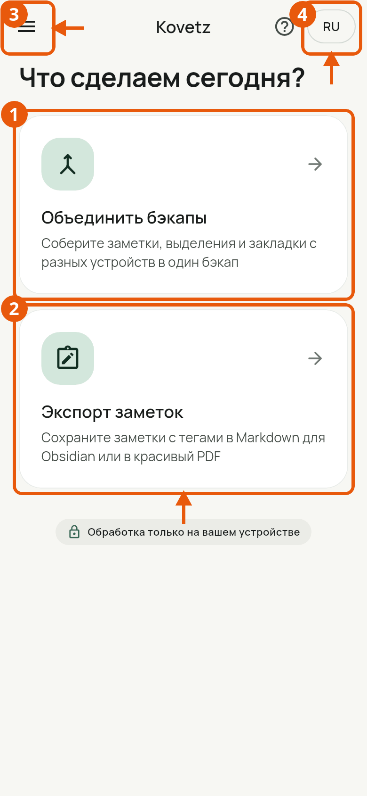

1 — «Объединить бэкапы». 2 — «Экспорт заметок». 3 — кнопка меню. 4 — кнопка с языком.

### 2. Откройте меню

Нажмите кнопку с тремя полосками. Выберите нужную строку, например «Как пользоваться», или нажмите «Главная», чтобы закрыть меню.

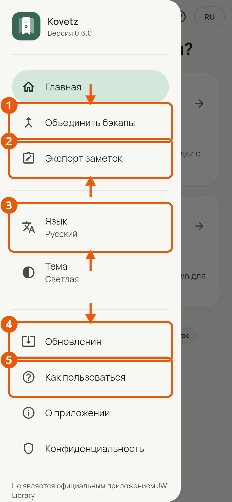

1 — «Объединить бэкапы». 2 — «Экспорт заметок». 3 — «Язык». 4 — «Обновления». 5 — «Как пользоваться».

### 3. Выберите язык

Нажмите кнопку с языком вверху или строку «Язык» в меню. В окне «Язык интерфейса» нажмите нужную строку.

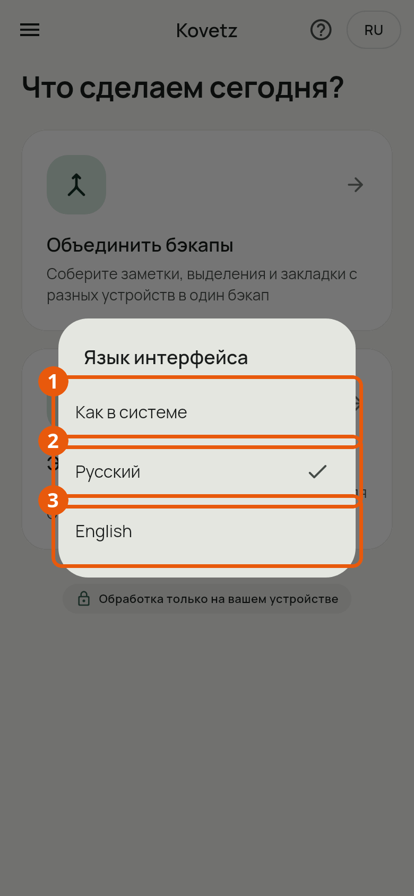

1 — «Как в системе», язык устройства. 2 — «Русский». 3 — английский язык.

### 4. Выберите тему

Откройте меню и нажмите «Тема». Нажмите «Светлая», «Тёмная» или «Системная», чтобы вид совпадал с настройкой устройства.

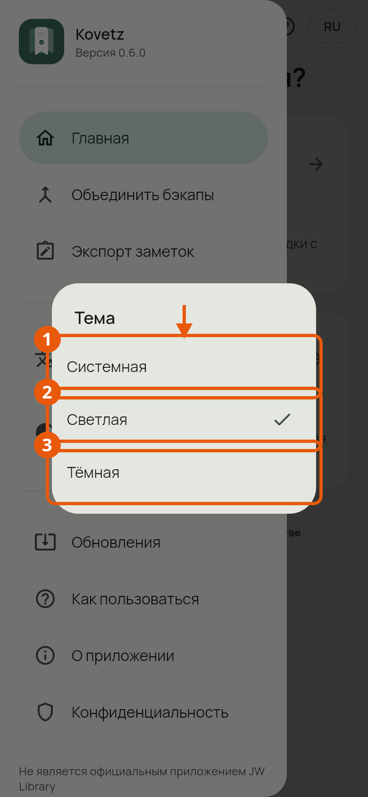

1 — «Системная». 2 — «Светлая». 3 — «Тёмная».

### 5. Посмотрите сведения о приложении

В меню нажмите «О приложении». Чтобы скопировать адрес проекта, нажмите «Исходный код — GitHub». Вставьте адрес в окно браузера, чтобы открыть страницу.

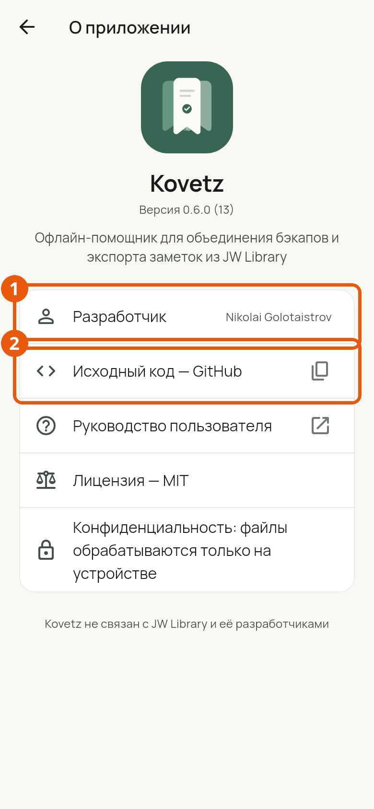

1 — «Разработчик», имя автора. 2 — «Исходный код — GitHub», кнопка для копирования ссылки.

## Сначала сохраните копии

Свежая копия помогает вернуть записи телефона, если вы захотите вернуться назад.

> **Важно.** Восстановление в JW Library заменяет личные записи на этом устройстве записями из выбранной копии. Новая заметка, которой в копии нет, может исчезнуть с телефона. Поэтому начните со свежей копии.

### 1. Откройте «Мои заметки»

На телефоне откройте JW Library. Перейдите в «Мои заметки».

### 2. Откройте меню копий

Нажмите значок облака со стрелкой. Выберите создание резервной копии.

### 3. Сохраните копию телефона

Выберите сохранение в файл, если телефон предложит варианты. Укажите папку, которую легко найти, и подтвердите сохранение.

### 4. Убедитесь, что файл на месте

Откройте папку в приложении для файлов. Запомните имя файла и место, где он лежит.

### 5. Сделайте копии на других устройствах

Повторите эти шаги на планшете и других устройствах с нужными записями. Если объединяете на компьютере, перенесите туда по копии каждого файла, например по кабелю.

### 6. Оставьте исходные копии у себя

Сохраните файлы, которые создала сама JW Library, в надёжном месте. Храните их и после объединения.

## Как объединить копии

Три экрана помогут выбрать файлы, настроить правила и сохранить результат.

### 1. Файлы · Начните объединение

На главном экране нажмите «Объединить бэкапы». На экране «Файлы» нажмите «Выбрать файлы».

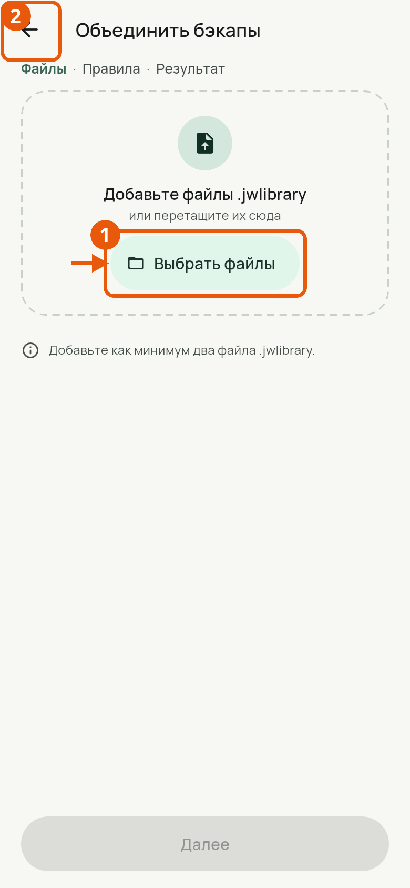

1 — «Выбрать файлы». 2 — стрелка назад, чтобы выйти с этого экрана.

### 2. Файлы · Добавьте две копии или больше

Выберите хотя бы две разные копии JW Library. Если получилось выбрать одну, снова нажмите «Выбрать файлы» и добавьте следующую.

### 3. Файлы · Выберите основную копию

Нажмите «Основной» со звёздочкой под нужным файлом. Этот файл задаёт порядок избранного и получает первый выбор мест для закладок.

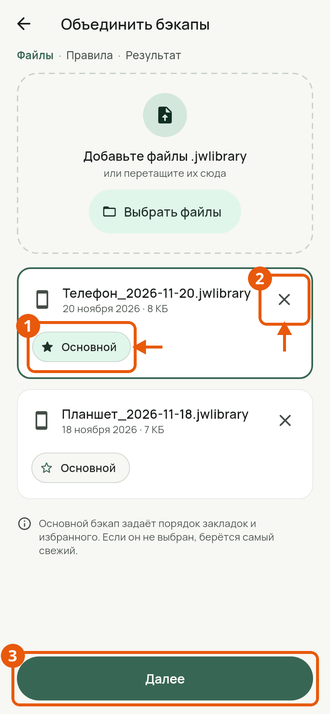

1 — «Основной». 2 — крестик «Убрать файл». 3 — «Далее».

### 4. Файлы · Проверьте список и продолжите

Если добавили лишний файл, нажмите крестик рядом с ним. Если звёздочка осталась пустой у всех файлов, приложение возьмёт самую свежую копию за основную. Нажмите «Далее».

### 5. Правила · Выберите версию заметок

В верхнем разделе нажмите «Самая свежая версия» или «Из основного бэкапа». Это правило нужно, когда одна и та же заметка была изменена по-разному.

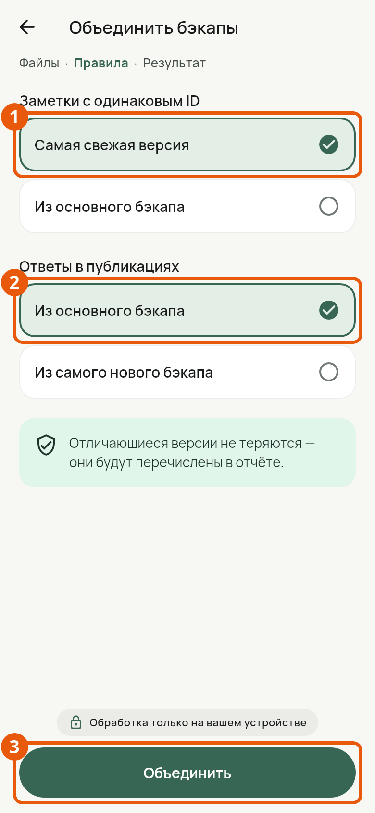

1 — «Самая свежая версия» для заметок. 2 — «Из основного бэкапа» для ответов. 3 — «Объединить».

### 6. Правила · Выберите версию ответов

В разделе «Ответы в публикациях» нажмите «Из основного бэкапа» или «Из самого нового бэкапа». При втором выборе важна дата всей копии.

> **Совет.** Если сомневаетесь, оставьте предложенные правила. Разные заметки сохраняются отдельно, а отличающиеся версии одной заметки или ответа можно прочитать в отчёте.

### 7. Правила · Запустите объединение

Нажмите «Объединить». Приложение откроет «Результат» и начнёт работу.

### 8. Результат · Дождитесь конца или отмените

Пока круг движется, подождите. Если хотите остановиться, нажмите «Отменить» и дождитесь остановки. Исходные файлы останутся как были.

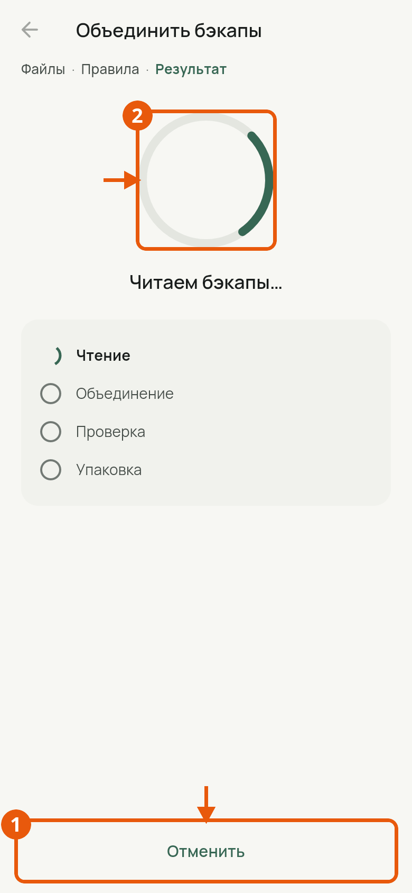

1 — «Отменить». 2 — движущийся круг, который показывает, что работа идёт.

### 9. Результат · Посмотрите, что получилось

Когда увидите «Готово», посмотрите числа под заголовком. Если есть жёлтая строка «Проверьте записи», сохраните результат и прочитайте отчёт перед восстановлением.

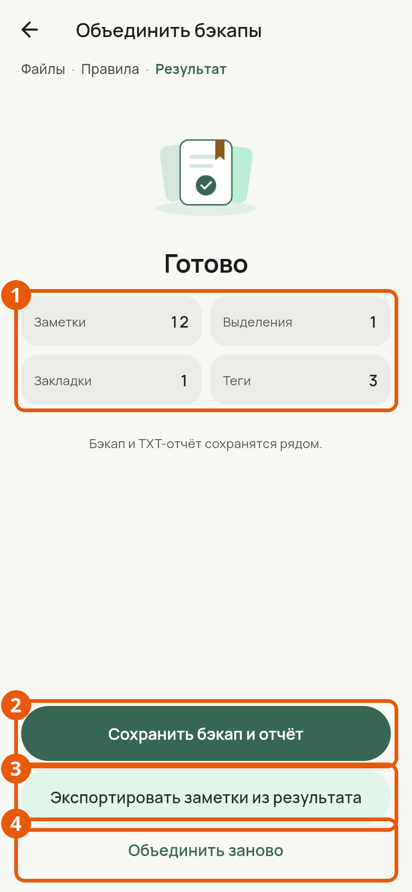

1 — сколько записей сохранилось. 2 — «Сохранить бэкап и отчёт». 3 — «Экспортировать заметки из результата». 4 — «Объединить заново».

> **Важно.** Жёлтая строка означает, что часть записей требует внимания. Например, для закладки могло не хватить места или мог отсутствовать файл для списка воспроизведения. В отчёте указано, что именно случилось.

### 10. Результат · Сохраните на своём устройстве

Нажмите «Сохранить бэкап и отчёт». На Android выберите папку и подтвердите выбор. На компьютере выберите папку и имя новой копии, затем нажмите «Сохранить».

### 11. Результат · Найдите оба файла

Откройте выбранную папку и проверьте, что в ней есть новая копия JW Library и TXT-отчёт. Если было предупреждение, откройте отчёт как обычный текст.

### 12. Результат · Продолжите, если нужно

Чтобы сохранить заметки отдельно, нажмите «Экспортировать заметки из результата». Чтобы выбрать файлы или правила ещё раз, нажмите «Объединить заново».

> **Совет.** Если закроете окно выбора папки, готовый результат останется на экране. На Android раньше сохранённые файлы остаются на месте. На компьютере при совпадении имён можно отменить замену и выбрать новое имя.

## Как открыть общую копию в JW Library

Проверьте свежую копию телефона перед тем, как восстановить общую.

### 1. Проверьте копию телефона

Убедитесь, что у вас есть свежий файл из главы «Сначала сохраните копии». Восстановление заменит личные записи JW Library на этом телефоне.

### 2. Найдите общую копию на телефоне

Если общая копия лежит на компьютере, скопируйте её на телефон, например по кабелю. Для восстановления нужен сам файл копии JW Library, а TXT-отчёт можно оставить рядом.

### 3. Откройте меню копий

Откройте JW Library и перейдите в «Мои заметки». Нажмите значок облака со стрелкой и выберите «Восстановить».

### 4. Выберите общую копию

Выберите общую копию из нужной папки. Если телефон открыл файл прямо в JW Library, дождитесь предложения восстановить его.

### 5. Подтвердите восстановление

Проверьте, что выбран нужный файл. Подтвердите восстановление и дождитесь его окончания.

### 6. Проверьте знакомые записи

Откройте «Мои заметки» и найдите знакомую заметку с каждого устройства. Проверьте также несколько важных тегов, закладок или выделений.

### 7. Если появились слова «Сохранённые данные повреждены»

Проверьте, что открыли саму общую копию и что файл перенёсся целиком. Если ошибка повторяется, снова объедините исходные копии в свежей версии Kovetz и сохраните результат под новым именем.

### 8. Вернитесь к записям телефона, если нужно

Если новая копия не подходит, тем же способом восстановите свежую копию самого телефона. Если ошибка повторяется с общей копией, запишите её текст и версию Kovetz из «О приложении» для разработчика.

## Как сохранить заметки отдельно

Заметки можно сохранить как папку для чтения или как книгу.

Приложение сохраняет ваш текст из заметок. Обычно в файл попадают только заметки с тегами. Выделения, закладки и текст публикаций отдельно не выгружаются.

### 1. Обзор · Откройте копию

На главном экране нажмите «Экспорт заметок», затем «Выбрать бэкап». Выберите файл JW Library и дождитесь списка.

### 2. Обзор · Или откройте результат объединения

На экране «Готово» нажмите «Экспортировать заметки из результата». Если вы открыли обычную копию и хотите взять другую, нажмите «Изменить».

### 3. Обзор · Найдите свою заметку

Нажмите «Поиск по заметкам» и введите слово. Нажмите тег под поиском, чтобы увидеть заметки с этой меткой.

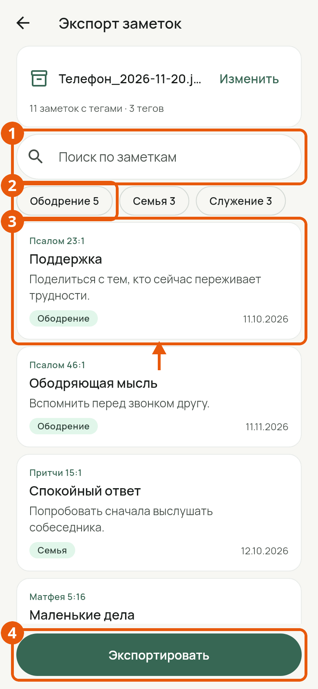

1 — «Поиск по заметкам». 2 — первый тег и число заметок с ним. 3 — первая карточка заметки. 4 — «Экспортировать».

### 4. Обзор · Перейдите к сохранению

Чтобы убрать поиск, нажмите крестик «Очистить», а для отмены отбора по тегу нажмите этот тег ещё раз. Нажмите «Экспортировать». Поиск и выбор тега меняют только список на экране.

### 5. Markdown · Выберите вид файла

Нажмите «Markdown для Obsidian». Если хотите взять и заметки без меток, включите «Добавить заметки без тегов».

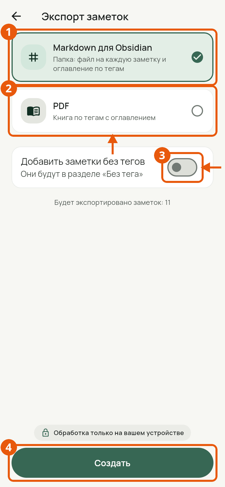

1 — «Markdown для Obsidian». 2 — «PDF». 3 — «Добавить заметки без тегов». 4 — «Создать».

### 6. Markdown · Сохраните

Нажмите «Создать». На компьютере выберите место для новой папки, а на Android укажите, куда сохранить ZIP.

### 7. Markdown · Распакуйте ZIP на телефоне

На Android найдите ZIP в приложении для файлов. Откройте его и выберите «Распаковать» или похожую кнопку. На компьютере готовая папка уже есть.

### 8. Markdown · Откройте папку в Obsidian

Откройте Obsidian и выберите открытие папки как хранилища. Укажите всю папку с экспортом, в которой виден «Указатель».

### 9. Markdown · Откройте «Указатель»

Нажмите «Указатель», чтобы перейти к тегам. В папке «Заметки» лежит по файлу на заметку, а в «Теги» лежат списки заметок по темам.

### 10. PDF · Выберите книгу

На экране выбора вида файла нажмите «PDF». По желанию включите «Добавить заметки без тегов», чтобы получить раздел «Без тега».

### 11. PDF · Задайте порядок и сохраните книгу

В разделе «Порядок внутри тега» нажмите «По Библии и публикациям» или «По дате», от ранних заметок к поздним. Нажмите «Создать». Дождитесь окна сохранения и выберите место для файла.

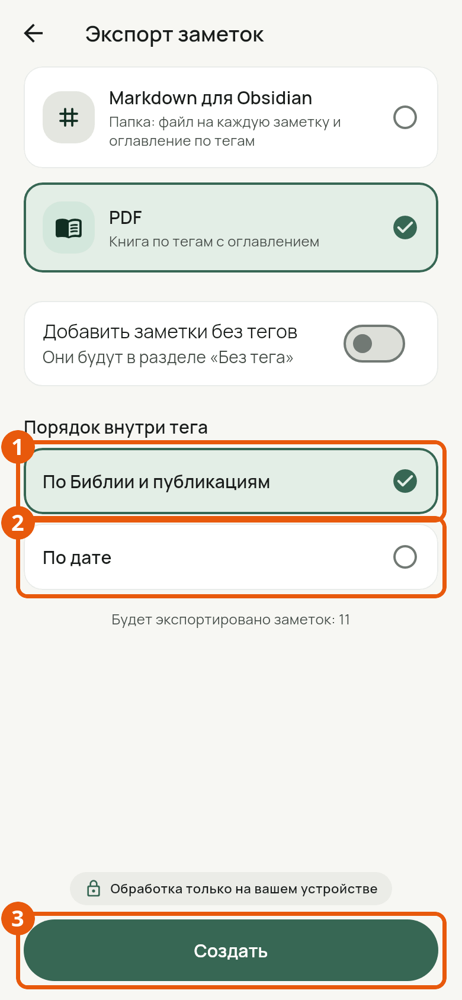

1 — два варианта порядка заметок внутри тега. 2 — «Создать».

> **Совет.** Для книги из примерно 1700 заметок создание может занять около 10 секунд. На медленном устройстве ожидание бывает дольше.

### 12. PDF · Откройте обложку и оглавление

Откройте сохранённый PDF. Чтобы перейти к теме, нажмите название тега в «Оглавлении по тегам» или найдите нужную страницу вручную.

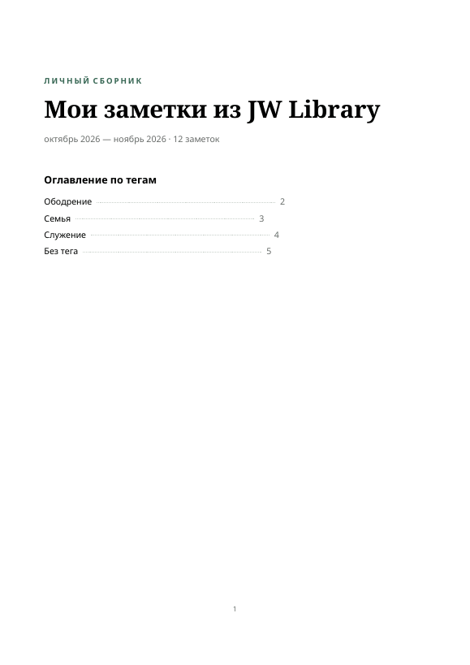

1 — название книги на обложке. 2 — оглавление со списком тегов.

### 13. PDF · Прочитайте заметки по теме

Листайте страницы выбранной темы. На странице книги нажимать кнопки не нужно. Если у заметки несколько тегов, она напечатана по одному разу в каждом из этих разделов.

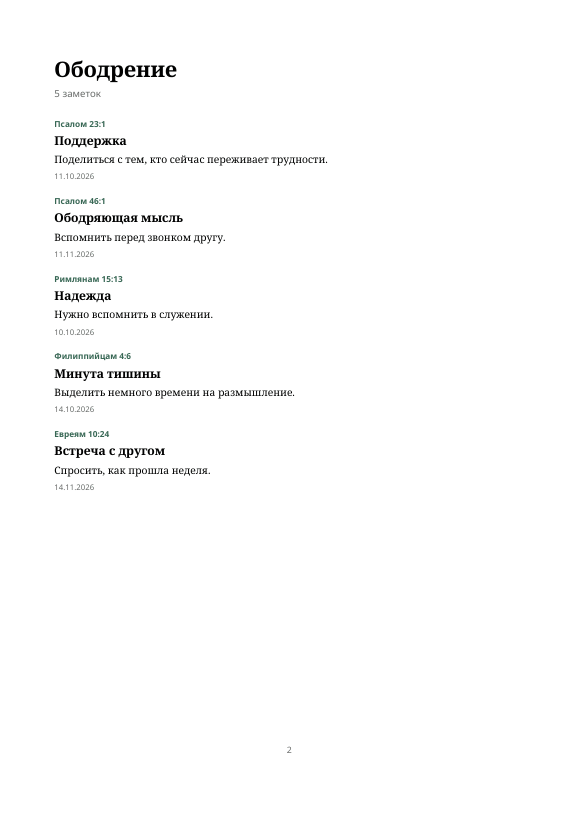

1 — название тега. 2 — текст заметки. Здесь можно просто читать.

> **Совет.** В PDF на каждой странице внизу есть кнопка «К оглавлению» и кнопка с названием текущего тега. После перехода по ссылке просто нажмите «К оглавлению», и вы снова наверху. Заметки в PDF также есть в панели закладок вашей программы для чтения PDF.

## Язык, тема и обновления

Настройки можно менять в любое время.

### 1. Установите язык

Откройте меню и нажмите «Язык». В окне «Язык интерфейса» нажмите «Русский», строку с английским языком или «Как в системе».

### 2. Установите тему

Откройте меню и нажмите «Тема». Выберите «Светлая», «Тёмная» или «Системная».

### 3. Проверьте обновления сами

Откройте меню и нажмите «Обновления». Нажмите «Проверить обновления» и подождите.

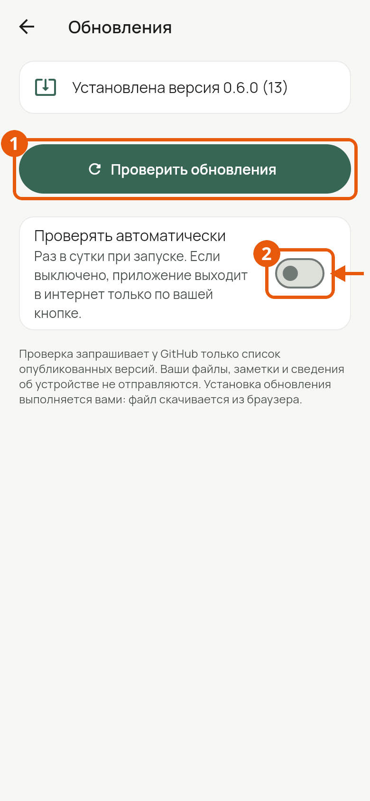

1 — «Проверить обновления». 2 — переключатель «Проверять автоматически».

### 4. Прочитайте ответ

Если написано «У вас последняя версия», можно продолжать работу. Если новая версия доступна, нажмите «Скачать» или «Страница релиза» и вернитесь к главе «Установка и обновление».

### 5. Включите или выключите проверку при запуске

Нажмите «Проверять автоматически», если хотите проверку при запуске раз в сутки. Сначала она выключена. Чтобы снова проверять только по кнопке, выключите её.

Для проверки Kovetz запрашивает у GitHub только список опубликованных версий. Проверка не отправляет ваши файлы, заметки или сведения об устройстве.

## Если что-то не получилось

Найдите знакомое сообщение или случай и попробуйте указанный шаг.

Перед сообщением может стоять имя файла. Оно подсказывает, какую копию проверить.

### 1. «Файл не удалось прочитать как бэкап JW Library»

Файл может быть другого вида или перенесён не полностью. Возьмите копию, которую создала JW Library, и перенесите её заново.

### 2. «Версия базы данных не совпадает с версией в описании бэкапа»

Две части файла по-разному описывают его вид. Сделайте новую копию в JW Library и добавьте её.

### 3. «Неизвестная структура таблицы»

Приложение встретило незнакомый способ хранения записей. Проверьте обновления и, если ошибка повторится, запишите точный текст для разработчика.

### 4. «Версия схемы бэкапа … пока не поддерживается»

Приложение пока не умеет читать такую копию. Сохраните её и попробуйте свежую копию из обновлённой JW Library.

### 5. «В базе бэкапа есть ссылки на отсутствующие записи»

Часть записей ссылается на другие записи, которых в файле нет. Выберите исправную исходную копию с нужного устройства.

### 6. «Не удалось проверить целостность базы данных»

Записи внутри файла не прошли проверку. Перенесите исходную копию ещё раз или создайте свежую в JW Library.

### 7. «Содержимое бэкапа не совпадает с его контрольной суммой»

Проверка показала, что содержимое отличается от сохранённого. Возьмите исходный файл и перенесите его ещё раз или сделайте новую копию.

### 8. «Бэкап слишком большой или содержит слишком много файлов»

Приложение остановилось из-за размера копии. Если есть более лёгкая исходная копия с нужными записями, попробуйте её и сохраните большую у себя.

### 9. «Отчёт о восстановлении … повреждён»

Приложение не может прочитать отчёт внутри старого результата. Выберите копии, которые создала сама JW Library.

### 10. «В бэкапе отсутствует медиафайл, на который ссылается плейлист»

В копии нет файла, нужного списку воспроизведения. Добавьте свежую копию с устройства, где этот файл ещё есть.

### 11. «Не удалось прочитать или записать файл»

Проверьте, что файл открывается с устройства и что в папке сохранения достаточно места. Повторите попытку или выберите другую папку.

### 12. «Объединение отменено»

Приложение остановилось по кнопке «Отменить». Чтобы начать снова, вернитесь к правилам и нажмите «Объединить».

### 13. «Внутренняя ошибка программы»

Что-то пошло не так внутри приложения, а исходные файлы остались как были. Повторите попытку один раз и, если ошибка вернётся, запишите её текст и версию приложения для разработчика.

### 14. «Добавьте как минимум два разных бэкапа»

Одного файла или двух одинаковых копий мало. Нажмите «Выбрать файлы» и добавьте другую копию JW Library.

### 15. «Не удалось объединить бэкапы»

Например, выбранная основная копия может быть недоступна. Вернитесь к списку, проверьте файлы и снова нажмите «Основной» под нужной копией.

### 16. Кнопка серая

Для «Далее» добавьте две разные копии, а для «Экспортировать» возьмите копию хотя бы с одной заметкой с тегом. Если приложение ещё читает или сохраняет файл, дождитесь окончания.

### 17. Добавили лишний файл

Вернитесь к экрану «Файлы» и нажмите крестик «Убрать файл» рядом с лишним именем. Если нужно, добавьте правильную копию кнопкой «Выбрать файлы».

### 18. На экране предыдущий результат

Если меняли язык, файлы или правила, нажмите «Объединить заново». Проверьте список и правила, затем нажмите «Объединить», чтобы снова можно было сохранить результат или заметки.

### 19. «Нет связи с GitHub»

Проверьте подключение и позже снова нажмите «Проверить обновления». Пока связи нет, можно объединять копии и сохранять заметки.

### 20. Отменили выбор папки или файла

Если закрыли окно сохранения, снова нажмите «Сохранить бэкап и отчёт» или «Создать» для заметок. Если закрыли окно выбора копии, откройте его снова, когда будете готовы.

### 21. Не удалось сохранить файлы

Проверьте свободное место и выберите другую папку или новое имя. Если приложение предупреждает о неполных файлах, используйте новый результат только после сообщения об успешном сохранении.

## Где остаются ваши данные

Файлы обрабатываются на вашем телефоне или компьютере.

Исходные файлы остаются там, где вы их положили. Новый бэкап, отчёт и выгруженные заметки сохраняются в выбранном вами месте. Отчёт тоже может содержать личный текст.

Интернет нужен приложению только для проверки обновлений. Приложение просит у GitHub список выпусков. Бэкапы, заметки и сведения об устройстве не отправляются.

Во время работы приложение делает временные копии в своём служебном месте на устройстве. После работы оно их убирает. Если работа прервалась, оно старается убрать оставшиеся копии при следующем запуске.

## Словарь простых слов

Здесь собраны короткие объяснения слов, которые встречаются на экране.

- Бэкап, или резервная копия. Файл, в котором JW Library сохраняет ваши записи, чтобы их можно было вернуть.
- Объединить. Собрать записи из нескольких копий в одну новую.
- Основной бэкап. Копия со звёздочкой, которая задаёт порядок избранного и первой получает места для закладок.
- Заметка. Текст, который вы написали для себя.
- Тег. Короткая метка темы, например «Семья». По ней удобно найти несколько заметок об одном и том же.
- Выделение. Место в тексте, которое вы отметили цветом.
- Закладка. Метка места, куда вы хотите потом вернуться.
- Отчёт. Текстовый файл рядом с общей копией. В нём написано, что сохранилось и что стоит проверить.
- Markdown. Простой вид текстового файла, в котором знаки помогают показать заголовки, списки и ссылки.
- Obsidian. Приложение для чтения и упорядочивания заметок из папки.
- PDF. Файл со страницами, которые можно читать и печатать как книгу.
- Релиз, или выпуск. Версия приложения, которую разработчик выложил для скачивания.
